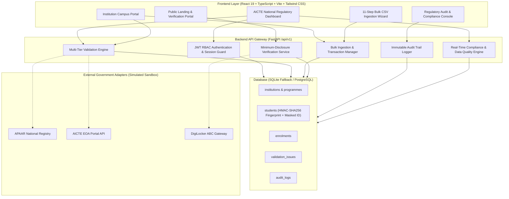

# APAARSetu — National APAAR-Based Student Data Management, Verification and Analytics Platform

**Smart India Hackathon 2026 Problem Statement: SIH26263**

[](https://fastapi.tiangolo.com/)
[](https://react.dev/)
[](https://www.typescriptlang.org/)
[](https://www.python.org/)
[](https://tailwindcss.com/)
[](#automated-testing)

---

## 1. Overview & Problem Statement

Higher education in India faces systemic challenges in managing student admissions and institutional quotas across thousands of AICTE-approved institutions:
- **Fragmented Records:** Disconnected institutional silos lead to duplicate student enrolments across universities concurrently.
- **Intake Violations:** Institutions admitting students beyond AICTE-approved intake capacity.
- **Missing or Dummy APAAR Identifiers:** Students admitted without mandatory Academic Bank of Credits (APAAR/ABC) registration.
- **Inconsistent Institutional Data:** Discrepancies between sanctioned EOA (Extension of Approval) limits and ground enrolments.
- **Lack of Centralized Verification:** Employers, background screening agencies, and foreign universities rely on paper transcripts prone to forgery.

**APAARSetu** is an AICTE regulatory platform that unifies student academic records using **APAAR (Automated Permanent Academic Account Registry)**, strictly enforces approved intake ceilings, detects multi-institution concurrent enrolments in real time, and enables privacy-preserving minimum disclosure verification.

---

## 2. System Architecture



---

## 3. Key Features

1. **Multi-Tier Validation Engine:**
   - 12-digit APAAR format and dummy sequence filter.
   - Batch-internal duplicate detection within uploaded files.
   - Database duplicate checking for identical academic sessions.
   - **Cross-Institution Conflict Detection:** Identifies concurrent active enrolments across different institutions.
   - **Sanctioned Intake Enforcement:** Compares regular admissions against official AICTE limits.
   - Segregates Supernumerary quotas (TFW, EWS, PMSSS, J&K) from regular intake ceiling.

2. **11-Step Bulk Ingestion Pipeline:**
   - Download official CSV template.
   - Drag & drop file upload with client & server-side validation.
   - Live paginated preview with row-level error tags and suggested remediations.
   - Downloadable CSV error reports for rejected rows.
   - Transactional commit: commits valid records and safely records rejected rows in the validation center.

3. **Privacy-Preserving Minimum Disclosure Verification:**
   - Tamper-proof digital seal using SHA-256 cryptographic digests.
   - Masks sensitive personal data (e.g. `R**** S*****`, `XXXX-XXXX-1234`).
   - Print-friendly verified academic certificate.

4. **Transparent Data Quality Score:**
   - Dynamically calculated 0-100 score based on APAAR coverage, duplicate frequency, and intake compliance.

5. **Immutable Regulatory Audit Trail:**
   - Every login, CSV submission, student creation, issue resolution, and verification inquiry is permanently logged.
   - Exportable to CSV for CAG / AICTE regulatory compliance.

---

## 4. Technology Stack

- **Frontend:** React 19, Vite, TypeScript, Tailwind CSS v4, Lucide React, Recharts, React Router v7, TanStack Query, Axios.
- **Backend:** Python 3.11+, FastAPI, Pydantic v2, SQLAlchemy 2.x, Passlib/Bcrypt, Pandas.
- **Database:** SQLite (default local fallback for zero-configuration hackathon demonstration) / PostgreSQL.
- **Testing:** Pytest (Backend API & Validation tests).
- **Deployment:** Docker, Docker Compose, Windows PowerShell native.

---

## 5. Demo Accounts

The development seed script automatically provisions accounts for each role with password `Password@123`. The login page also features a **One-Click Demo Role Switcher**.

| Role | Email | Password | Access Scope |
|---|---|---|---|
| **AICTE Administrator** | `aicte.admin@apaarsetu.gov.in` | `Password@123` | National command center, all institutions, approval references, cross-institution alerts |
| **Institution Admin (IIT Delhi)** | `admin@iitd.ac.in` | `Password@123` | IIT Delhi campus, student enrolment, CSV upload, intake monitor |
| **Institution Admin (BITS Pilani)** | `admin@bits-pilani.ac.in` | `Password@123` | BITS Pilani campus (tenant isolated from IIT Delhi) |
| **Authorized Verifier (TCS)** | `verifier@tcs.com` | `Password@123` | Employer verification portal, digital certificate receipt generation |
| **Regulatory Auditor (CAG)** | `auditor@cag.gov.in` | `Password@123` | Read-only compliance audit trail, exports, and analytics |
| **Student Portal** | `student@iitd.ac.in` | `Password@123` | View own academic profile, digital credentials, submit correction request |

---

## 6. Getting Started (Local Setup)

### Prerequisites
- Python 3.11+
- Node.js 18+ & npm
- Git

---

### Method A: Windows PowerShell Setup (Step-by-Step)

#### 1. Backend Setup
```powershell
# Open Windows PowerShell in the project root
cd backend

# Create virtual environment
python -m venv venv

# Activate virtual environment
.\venv\Scripts\Activate.ps1

# Install dependencies
pip install -r requirements.txt

# Seed the database with demo institutions, programmes, users, and students
python -m app.scripts.seed

# Start the FastAPI backend server
python -m uvicorn app.main:app --host 127.0.0.1 --port 8000 --reload
```
*Backend Swagger UI will be live at:* `http://127.0.0.1:8000/docs`

#### 2. Frontend Setup (In a New Terminal)
```powershell
# In another PowerShell window, navigate to frontend
cd frontend

# Install frontend dependencies
npm install --legacy-peer-deps

# Start Vite development server
npm run dev
```
*Frontend application will be live at:* `http://localhost:5173`

---

### Method B: Docker Compose Setup

```bash
# Build and run backend and frontend containers
docker-compose up --build
```
- Frontend: `http://localhost:5173`
- Backend API: `http://localhost:8000/docs`

---

## 7. Automated Testing

Run the automated backend test suite covering authentication, validation rules, intake limits, tenant isolation, and verification lookups:

```powershell
cd backend
.\venv\Scripts\python.exe -m pytest -v
```

**Test Coverage Summary:**
- `test_password_hashing`: Verifies bcrypt cryptographic hashing and salt verification.
- `test_login_success`: Validates AICTE admin token generation and claims.
- `test_login_invalid_password`: Verifies rejection of incorrect credentials.
- `test_login_institution_admin`: Verifies campus tenant isolation binding.
- `test_create_and_fetch_student_logic`: End-to-end student creation and retrieval.
- `test_tenant_isolation_violation`: Confirms 403 Forbidden when institution admin attempts cross-campus write.
- `test_cross_institution_duplicate_rejection`: Confirms rejection of student already enrolled in another institution.
- `test_csv_preview_and_commit_flow`: Tests 11-step batch upload, error report generation, and transactional commit.
- `test_apaar_format_checker`: Tests 12-digit numeric validation and dummy pattern filter.
- `test_batch_validation_duplicate_and_cross_institution`: Validates batch-internal collision detection.
- `test_student_verification_found`: Confirms minimal disclosure verification response and SHA-256 seal.
- `test_student_verification_not_found`: Confirms safe handling of nonexistent identifiers.

---

## 8. Complete End-to-End Workflow Walkthrough

1. **Launch Frontend:** Open `http://localhost:5173`.
2. **Review Public Landing Page:** Inspect problem statement SIH26263, pillars, and verification gateway.
3. **Login as AICTE Admin:** Click *Portal Login* -> Click *AICTE Admin* quick switcher -> Click *Sign In*.
4. **AICTE Dashboard:** Inspect national figures, intake utilization, and high-priority cross-institution alerts.
5. **Review Institutions:** Go to *Institutions Registry* (`/admin/institutions`) -> View IIT Delhi & BITS Pilani.
6. **Switch to Campus Admin:** Sign out -> Select *IIT Delhi Admin* (`admin@iitd.ac.in`).
7. **Test Single Student Enrolment:**
   - Go to *Enrolled Students* (`/students`) -> Click *Add Student*.
   - Try entering APAAR ID `112233445566` (which belongs to BITS Pilani student Karan Malhotra).
   - Observe immediate **CROSS-INSTITUTION CONFLICT** regulatory blocking error!
8. **Test Bulk CSV Ingestion (11-Step Pipeline):**
   - Navigate to *Bulk CSV Upload* (`/upload`).
   - Click *Download Official CSV Template*.
   - Upload `sample_data/batch_with_duplicates_and_overrun.csv`.
   - Click *Run Pre-Submission Validation*.
   - Inspect diagnostic findings: duplicate in file, invalid format, missing APAAR, and cross-institution collision flagged with exact row numbers and suggested fixes.
   - Click *Download Error Report CSV*.
   - Click *Commit Valid Students* to transactionally enroll clean records.
9. **Resolve Validation Issues:**
   - Navigate to *Validation Issues* (`/validation`).
   - Select an issue -> Click *Review & Resolve* -> Provide resolution notes and submit.
10. **Test Employer Verification Portal:**
    - Navigate to *Verification Portal* (`/verify`).
    - Enter APAAR ID `849302194821` (Aarav Sharma) -> Select *Employment Background Verification*.
    - Click *Perform Verified Lookup*.
    - Inspect minimal disclosure certificate, masked name, and cryptographic SHA-256 seal.
    - Click *Print Official Verification Receipt*.
11. **Regulatory Audit Trail:**
    - Navigate to *Audit Trail* (`/audit`).
    - Confirm all logins, CSV submissions, and verification events were immutably recorded with non-sensitive metadata.
    - Click *Export Audit Trail (CSV)*.

---

## 9. Security & Compliance Notes

- **Zero Plaintext Storage:** Plaintext APAAR IDs are discarded immediately after computing the HMAC-SHA256 fingerprint.
- **Tenant Isolation:** Enforced at database and API levels; institution administrators cannot read or modify another campus's records.
- **Data Retention:** Configured for 7 years in accordance with national academic governance policies.
- **Simulated Gateway Disclosure:** For hackathon evaluation, integration with APAAR and AICTE servers operates in a simulated sandbox mode with authentic data schemas.

---

## 10. Future Official Integrations

When connecting to production AICTE / APAAR government gateways:
1. Obtain official production API keys and mutual TLS (mTLS) client certificates from AICTE / Ministry of Education.
2. In `.env`, set:
   ```env
   INTEGRATION_MODE=CONNECTED
   AICTE_API_BASE_URL=https://api.aicte-india.org/v1
   APAAR_API_BASE_URL=https://api.apaar.gov.in/v1
   AICTE_API_KEY=<OFFICIAL_AICTE_KEY>
   APAAR_API_KEY=<OFFICIAL_APAAR_KEY>
   ```
3. Update `app/integrations/apaar_adapter.py` and `aicte_adapter.py` with official XML/JSON signing credentials.

---

*Built with pride for Smart India Hackathon 2026 • SIH26263*
