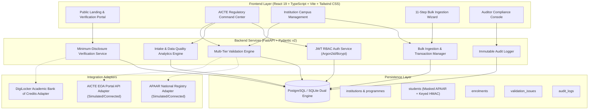
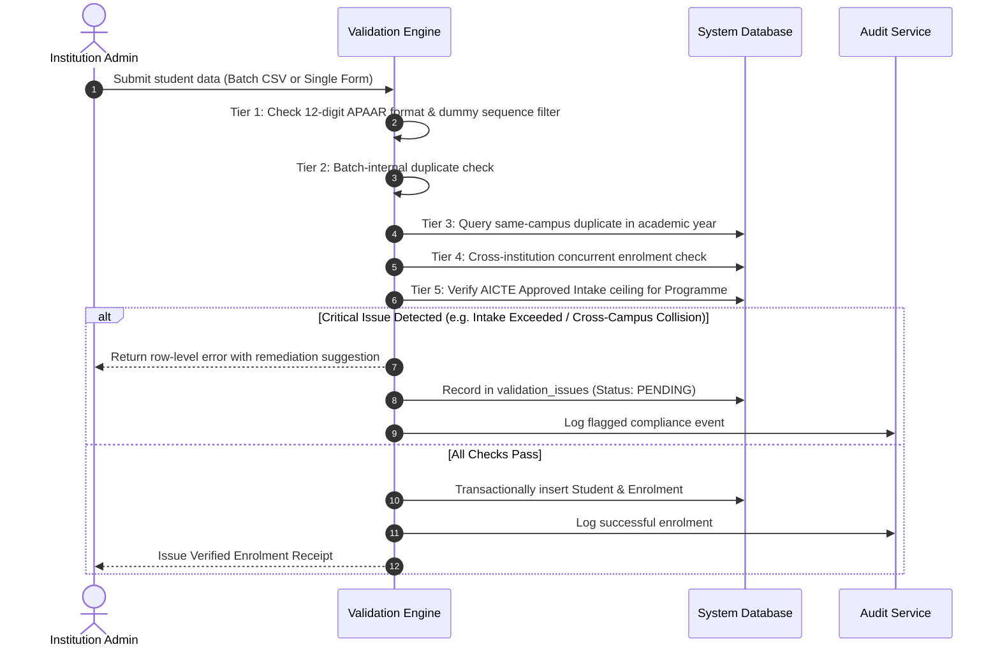

# EduVerify AI — Technical Architecture & Design Document

**Smart India Hackathon 2026 Problem Statement SIH26263**

---

## 1. Executive Summary

EduVerify AI is an enterprise-grade regulatory compliance, student record management, and verification platform designed for the All India Council for Technical Education (AICTE) and higher educational institutions nationwide. The platform solves the chronic issues of:
1. Fragmented institutional student records
2. Dual enrolments and cross-institution ghost admissions
3. Admissions exceeding approved intake limits
4. Missing, unlinked, or malformed APAAR identifiers
5. Insecure, unverified credentials shared with employers

---

## 2. High-Level System Architecture

---

## 3. Data Privacy & Cryptographic Model

### A. Privacy-Preserving Keyed Fingerprint (HMAC-SHA256)
APAAR IDs are sensitive national academic identifiers. To comply with Indian data privacy mandates and prevent unrestricted identifier enumeration:
- The full plaintext APAAR ID is **never** saved directly into public database columns.
- Instead, the platform computes a keyed HMAC-SHA256 fingerprint:
  $$\text{Fingerprint} = \text{HMAC-SHA256}(\text{Secret Key}, \text{Cleaned APAAR})$$
- This allows deterministic $O(1)$ duplicate checking across millions of records without exposing the underlying identifier.
- User interfaces and system logs display only the masked representation: `XXXX-XXXX-1234`.

### B. Minimum Disclosure Verification
When employers or third parties verify a student:
- They supply the candidate's APAAR ID or admission ID and verification purpose.
- The platform returns only:
  - Verification Status (`VERIFIED`, `PENDING_REVIEW`, `NOT_VERIFIED`)
  - Masked Name (`R**** S*****`)
  - Masked APAAR (`XXXX-XXXX-1234`)
  - Enrolled Programme & Qualification Level
  - Institution Name & AICTE Code
  - Digital Seal (SHA-256 Digest of Verification Event)
- Full personal details (DOB, address, category, phone) are strictly redacted.

---

## 4. Multi-Tier Validation Pipeline

Every student record (manual or batch CSV) undergoes synchronous multi-tier validation:

